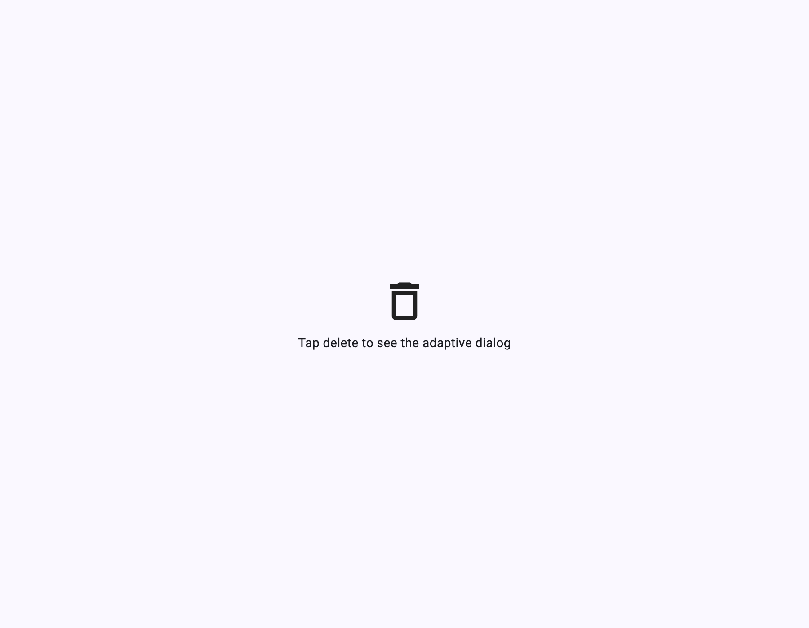

# prism_adaptive_dialog

**Adaptive dialogs for Flutter** — modal bottom sheets on phones, centered
dialogs on tablets and desktops, from a single call. The companion to
[`prism_adaptive_scaffold`](https://pub.dev/packages/prism_adaptive_scaffold).
Pure Flutter — no platform channels, works on all six platforms.

## Features

- ✅ One call → bottom sheet on compact, centered dialog on medium+
- ✅ Full override control per window class (`PresentationStyle`)
- ✅ Pre-styled actions: `cancel`, `primary`, `destructive`
- ✅ Optional `title`, barrier dismissal, safe areas, max width
- ✅ Material 3 by default; adapts to your `ThemeData`
- ✅ All six Flutter platforms: Android, iOS, macOS, Windows, Linux, Web

## Installation

```yaml
dependencies:
  prism_adaptive_dialog: ^0.1.0
```

## Usage

```dart
final confirmed = await PrismAdaptiveDialog.show<bool>(
  context,
  title: 'Delete item?',
  builder: (context) => const Text('This cannot be undone.'),
  actions: [
    AdaptiveDialogAction.cancel(context),
    AdaptiveDialogAction.destructive(
      context,
      label: 'Delete',
      onPressed: () => Navigator.pop(context, true),
    ),
  ],
);
```

On a 400px-wide phone this opens as a bottom sheet; on a 1200px desktop it
opens as a centered dialog. Same code, correct UX everywhere.

### Force a specific presentation

```dart
PrismAdaptiveDialog.show(
  context,
  presentation: PresentationStyle.dialog,     // always centered
  // presentation: PresentationStyle.bottomSheet, // always a sheet
  builder: (context) => const Text('Content'),
);
```

### With prism_adaptive_scaffold

Breakpoints are shared, so dialogs inside `PrismAdaptiveScaffold` layouts
automatically pick the right presentation for the current window class.

## The Prism package family

Shares breakpoints with `prism_adaptive_scaffold`, so dialogs inside its layouts pick the right presentation automatically:

| Package | What it does |
| --- | --- |
| [prism_markdown](https://pub.dev/packages/prism_markdown) | Markdown widget with full CommonMark + GFM support |
| [prism_code_view](https://pub.dev/packages/prism_code_view) | Syntax-highlighted code viewer (Dart/JSON/YAML built in) |
| [prism_adaptive_scaffold](https://pub.dev/packages/prism_adaptive_scaffold) | Responsive scaffolds: bottom bar → rail → extended rail |
| [prism_adaptive_dialog](https://pub.dev/packages/prism_adaptive_dialog) | Dialogs that become bottom sheets on phones |

All pure Flutter, all six platforms, MIT licensed, built to work together.

## Screenshot

<p align="center">
  
</p>

## License

MIT — see [LICENSE](LICENSE).
